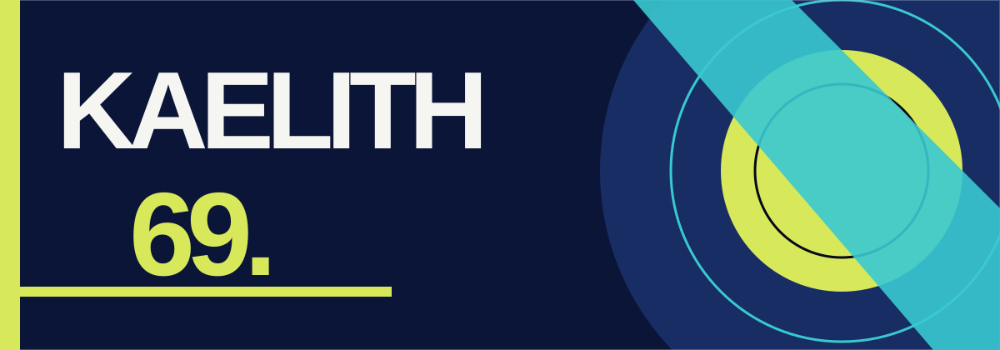

<div align="center">
  
</div>

# KAELITH69

A personal portfolio for selected software projects, digital experiments and contact links.

**[View the live site](https://kaelith69.github.io/kaelith69-cosmic-journey/)**

## Projects

The portfolio currently features:

- **PickMe:** Private love letters and a public message wall.
- **Prism:** AI assisted presentation creation with SVG visuals and PDF export.
- **GodView:** Configurable dashboard module with geospatial mapping and CSV export.
- **Medic:** Medicine label reader with on device text recognition, speech and reminders.
- **Emo:** Cross platform companion for contextual AI conversations.
- **WRDLiNK:** Four letter word ladder game with dictionary validation and shortest path solving.

Each project links to its source repository.

## Built with

- HTML
- CSS
- JavaScript

The site is a static page. It has no package manifest, build step, application framework or backend.

## Run locally

A local HTTP server is sufficient.

```bash
git clone https://github.com/Kaelith69/kaelith69-cosmic-journey.git
cd kaelith69-cosmic-journey
python -m http.server 8000
```

Open [http://localhost:8000](http://localhost:8000).

## Deployment

GitHub Actions deploys the repository root to GitHub Pages when changes are pushed to `main`. The workflow is defined in [pages.yml](.github/workflows/pages.yml).

## Repository structure

```text
.
├── .github/
│   └── workflows/
│       └── pages.yml
├── assets/
│   └── cosmic-banner.svg
├── index.html
├── QA_REPORT.md
└── README.md
```

## Notes

- The portfolio links to selected public repositories and profile pages. It does not embed those projects.
- There is no contact form or backend.
- No licence file is currently present in the repository.
